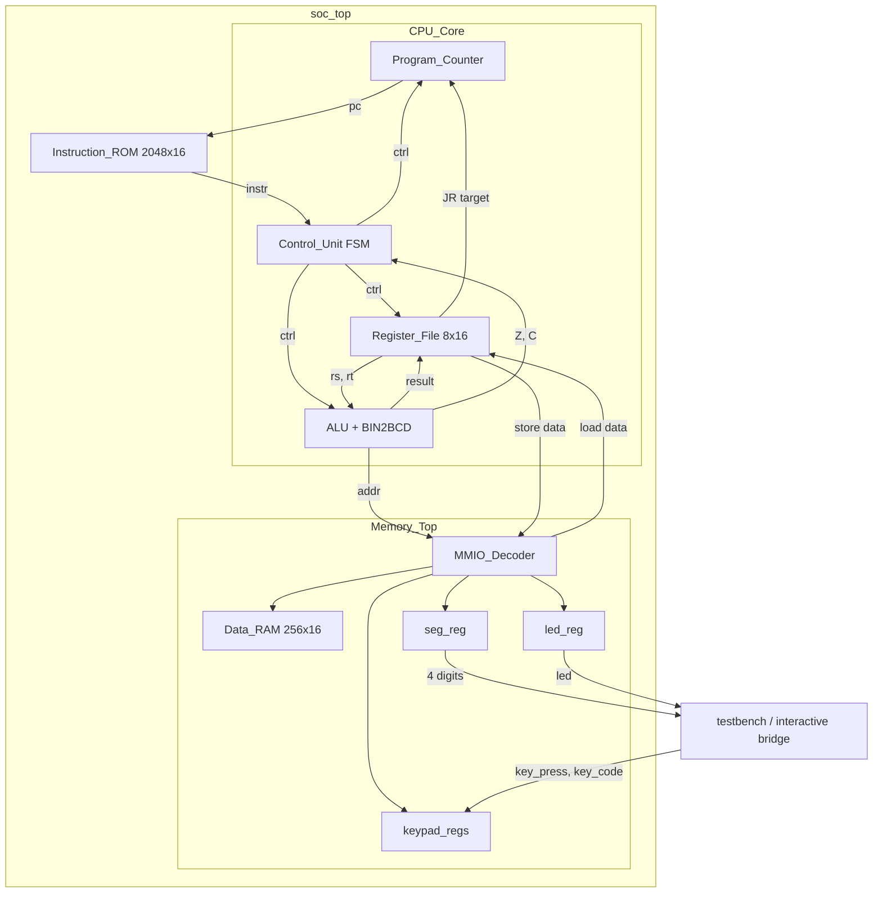

# ISA Manual: 16-битное процессорное ядро (черновик v0.2)

Курсовая работа «Проектирование процессорного ядра и разработка интерактивной SoC».
Вариант: ИУ5-51Б, №4 → задачи **3** (пузырьковая сортировка), **4** (Vending Machine), **21** (Hardware Calculator, `BIN2BCD`).

---

## 1. Общие параметры

| Параметр | Значение |
|---|---|
| Архитектура | Гарвардская (отдельные память команд и память данных), load/store |
| Разрядность данных | 16 бит, целые числа без знака |
| Ширина команды | 16 бит, фиксированная |
| Адресация | словная (адрес указывает на 16-битное слово) |
| Память команд (ROM) | 2048 слов × 16 бит, адреса `0x000`–`0x7FF`, счётчик команд PC — 11 бит |
| Память данных (RAM) | 256 слов × 16 бит, адреса `0x0000`–`0x00FF` |
| Регистровый файл | 8 регистров `R0`–`R7`, по 16 бит |
| Флаги АЛУ | `Z` (ноль), `C` (перенос / отсутствие заёма) |
| Сброс | синхронный, активный уровень 1 (`rst`) |
| Подпрограммы | через `JR` и регистр связи `R7` (псевдоинструкции `CALL`/`RET`), один уровень вложенности, аппаратного стека нет |
| Прерывания, таймеры | не реализуются |

### Регистры

- `R0` всегда равен `0`. Запись в `R0` игнорируется (флаги при этом обновляются как обычно).
- `R1`–`R7` — регистры общего назначения.
- Программные соглашения (аппаратно не закреплены): `R7` — регистр связи (адрес возврата из подпрограммы); `R6` — база MMIO (`0xFF00`), при нехватке регистров базу можно пересобрать двумя командами `LDI`+`LHI`.
- По сбросу: `PC = 0`, `R1`–`R7 = 0`, `Z = 0`, `C = 0`, признак останова снят.

---

## 2. Форматы команд

Все команды — 16 бит. Поле кода операции `op` — 5 бит `[15:11]`.

| Формат | [15:11] | [10:8] | [7:5] | [4:2] | [1:0] | Использование |
|---|---|---|---|---|---|---|
| **R** | op | rd | rs | rt | 00 | регистр-регистр |
| **I** | op | rd | rs | imm5 `[4:0]` | | `ADDI`, `LOAD`, `STORE` |
| **L** | op | rd | imm8 `[7:0]` | | | `LDI`, `LHI` |
| **J** | op | addr / offset 11 бит `[10:0]` | | | | `JUMP`, ветвления |

Подробнее:

```
R: | op[15:11] | rd[10:8] | rs[7:5] | rt[4:2] | 00[1:0] |
I: | op[15:11] | rd[10:8] | rs[7:5] | imm5[4:0]          |   imm5 — со знаком (−16…+15)
L: | op[15:11] | rd[10:8] | imm8[7:0]                      |
J: | op[15:11] | field11[10:0]                              |
```

Неиспользуемые поля кодируются нулями.

---

## 3. Система команд

Обозначения: `sext` — знаковое расширение до 16 бит, `zext` — нулевое расширение, `M[...]` — память данных.

| Мнемоника | Код (bin) | Код (hex) | Формат | Операция | Флаги |
|---|---|---|---|---|---|
| `ADD rd, rs, rt` | 00000 | 0x00 | R | rd ← rs + rt | Z, C |
| `SUB rd, rs, rt` | 00001 | 0x01 | R | rd ← rs − rt | Z, C |
| `AND rd, rs, rt` | 00010 | 0x02 | R | rd ← rs & rt | Z, C←0 |
| `OR  rd, rs, rt` | 00011 | 0x03 | R | rd ← rs \| rt | Z, C←0 |
| `XOR rd, rs, rt` | 00100 | 0x04 | R | rd ← rs ^ rt | Z, C←0 |
| `NOT rd, rs` | 00101 | 0x05 | R | rd ← ~rs | Z, C←0 |
| `SHL rd, rs` | 00110 | 0x06 | R | rd ← rs << 1 | Z, C←rs[15] |
| `SHR rd, rs` | 00111 | 0x07 | R | rd ← rs >> 1 (логический) | Z, C←rs[0] |
| `CMP rs, rt` | 01000 | 0x08 | R | вычисляет rs − rt, результат не сохраняется | Z, C |
| `BIN2BCD rd, rs` | 01001 | 0x09 | R | rd ← упакованный BCD из rs (кастомная, см. п. 5) | Z, C |
| `ADDI rd, rs, imm5` | 01010 | 0x0A | I | rd ← rs + sext(imm5) | Z, C |
| `LDI rd, imm8` | 01011 | 0x0B | L | rd ← zext(imm8) | — |
| `LHI rd, imm8` | 01100 | 0x0C | L | rd[15:8] ← imm8, rd[7:0] не меняется | — |
| `LOAD rd, [rs+imm5]` | 01101 | 0x0D | I | rd ← M[rs + sext(imm5)] | — |
| `STORE rd, [rs+imm5]` | 01110 | 0x0E | I | M[rs + sext(imm5)] ← rd | — |
| `JUMP addr` | 01111 | 0x0F | J | PC ← addr[10:0] | — |
| `BEQ off` | 10000 | 0x10 | J | если Z=1: PC ← PC + 1 + sext(off11) | — |
| `BNE off` | 10001 | 0x11 | J | если Z=0: PC ← PC + 1 + sext(off11) | — |
| `BLO off` | 10010 | 0x12 | J | если C=0: PC ← PC + 1 + sext(off11) | — |
| `BHS off` | 10011 | 0x13 | J | если C=1: PC ← PC + 1 + sext(off11) | — |
| `HLT` | 10100 | 0x14 | J | остановить выполнение (PC не меняется до сброса) | — |
| `JR rs` | 10101 | 0x15 | R | PC ← rs[10:0] (косвенный переход; rd, rt = 0) | — |

Прочие коды (`0x16`–`0x1F`) зарезервированы и выполняются как `HLT`: процессор, попавший в мусор, останавливается.
Слово `0x0000` декодируется как `ADD R0, R0, R0`, то есть как **NOP**.

В ветвлениях `PC` — адрес самой команды ветвления; если условие не выполнено, `PC ← PC + 1`.

### Псевдоинструкции ассемблера (подпрограммы)

```
CALL label  →  LDI R7, lo(ret) ; LHI R7, hi(ret) ; JUMP label    ; ret = адрес команды после CALL
RET         →  JR R7
```

`LDI`, `LHI` и `JUMP` не меняют флаги, поэтому флаги сохраняются при вызове. Адрес возврата — 11 бит, то есть `hi(ret) ≤ 0x07`. Вложенные вызовы без стека невозможны: при необходимости `R7` сохраняется в RAM вручную.

### Режимы адресации

| Режим | Где используется |
|---|---|
| Регистровая | `ADD`, `SUB`, `AND`, `OR`, `XOR`, `NOT`, `SHL`, `SHR`, `CMP`, `BIN2BCD` |
| Непосредственная (imm) | `ADDI` (imm5 со знаком), `LDI`, `LHI` (imm8) |
| Базовая со смещением | `LOAD`, `STORE`: адрес = `rs + sext(imm5)` |
| Относительная по PC | `BEQ`, `BNE`, `BLO`, `BHS` (смещение 11 бит со знаком, ±1024) |
| Абсолютная | `JUMP` (адрес 11 бит) |
| Регистровая косвенная | `JR` (адрес перехода берётся из `rs`) |

---

## 4. Флаги АЛУ

Используется беззнаковая арифметика. Знаковые числа калькулятор обрабатывает программно (знак и модуль).

| Команда | Z | C |
|---|---|---|
| `ADD` | результат = 0 | перенос из старшего (15-го) разряда |
| `SUB`, `CMP` | результат = 0 | **1, если заёма не было** (rs ≥ rt, беззнаково); 0, если rs < rt |
| `ADDI` | результат = 0 | перенос из 15-го разряда 16-битной суммы `rs + sext(imm5)`. При `imm5 < 0` это эквивалентно вычитанию: `C = 1`, если заёма нет (например, `ADDI R1, R1, -1` даёт `C = 0` только при `R1 = 0`) |
| `AND`, `OR`, `XOR`, `NOT` | результат = 0 | 0 |
| `SHL` | результат = 0 | выдвинутый бит `rs[15]` |
| `SHR` | результат = 0 | выдвинутый бит `rs[0]` |
| `BIN2BCD` | результат = 0 | 1, если `rs ≥ 10000` (результат не поместился в 4 цифры) |

Команды `LDI`, `LHI`, `LOAD`, `STORE`, `JUMP`, ветвления и `HLT` флаги не меняют.

### Условия переходов

| Нужно | Последовательность |
|---|---|
| a == b | `CMP a, b` → `BEQ` |
| a != b | `CMP a, b` → `BNE` |
| a < b (беззнаково) | `CMP a, b` → `BLO` |
| a ≥ b | `CMP a, b` → `BHS` |
| a > b | `CMP b, a` → `BLO` |
| проверка младшего бита | `SHR t, x` → `BHS` (бит = 1) / `BLO` (бит = 0) |
| сравнение с константой k = 1…16 | `ADDI R0, rs, -k` → `BEQ` (rs = k) / `BHS` (rs ≥ k) / `BLO` (rs < k) |

Примечание: `CMP rs, rt` эквивалентна `SUB R0, rs, rt`, потому что запись в `R0` игнорируется, а флаги обновляются. Отдельный код `CMP` оставлен для читаемости программ.

---

## 5. Кастомная инструкция `BIN2BCD` (Hardware Acceleration, задача №21)

`BIN2BCD rd, rs`: преобразует 16-битное двоичное число в упакованный BCD (4 тетрады по 4 бита).
Реализуется аппаратно, комбинационно (алгоритм double dabble), результат за такт выполнения инструкции.

- `rd[3:0]` — единицы, `rd[7:4]` — десятки, `rd[11:8]` — сотни, `rd[15:12]` — тысячи.
- Для `rs ≥ 10000` в `rd` попадают младшие 4 десятичные цифры (`rs mod 10000`), а флаг `C = 1`.
- Результат можно сразу записать в регистр вывода `SEG` (см. п. 6).
- Замечание по реализации: комбинационная цепочка double dabble на 16 бит глубокая и может стать критическим путём при синтезе (ограничит Fmax). Если это произойдёт, инструкцию можно сделать многотактной (последовательный double dabble за 16 тактов) без изменения ISA.

---

## 6. Карта адресного пространства

### Память команд (отдельное адресное пространство)

| Диапазон | Назначение |
|---|---|
| `0x000`–`0x7FF` | Instruction ROM, 2048 × 16, загружается через `$readmemh`/`$readmemb` |

### Память данных

| Диапазон | Назначение |
|---|---|
| `0x0000`–`0x00FF` | Data RAM, 256 × 16, начальные данные грузятся через `$readmemb` |
| `0x0100`–`0xFEFF` | не используется (чтение даёт 0, запись игнорируется) |
| `0xFF00`–`0xFF03` | MMIO-регистры (см. ниже) |
| `0xFF04`–`0xFFFF` | не используется (чтение даёт 0, запись игнорируется) |

### MMIO-регистры

| Адрес | Имя | Доступ | Описание |
|---|---|---|---|
| `0xFF00` | `KEY_STATUS` | R | бит 0 = `VALID`: есть непрочитанное нажатие клавиши; остальные биты 0 |
| `0xFF01` | `KEY_DATA` | R | биты `[3:0]` — код клавиши 0…15 (строка×4 + столбец), остальные 0. **Чтение сбрасывает `VALID`** |
| `0xFF02` | `LED` | R/W | 16 светодиодов, бит = 1 — горит |
| `0xFF03` | `SEG` | R/W | 4 семисегментных разряда, по 4 бита на разряд (см. ниже) |

Кодирование тетрады разряда `SEG` (`[3:0]` — правый разряд, `[15:12]` — левый):

| Значение | Показывает |
|---|---|
| `0x0`–`0x9` | цифра 0–9 |
| `0xA` | знак «−» |
| `0xE` | буква «E» (ошибка) |
| `0xF` и остальные | разряд погашен |

Если нажатие приходит, когда `VALID = 1`, оно игнорируется (источник нажатий обязан повторить его позже). Детали интерфейса моста определяются на этапе 5.

Требования к реализации MMIO:
- Побочный эффект чтения `KEY_DATA` (сброс `VALID`) выполняется по строб-сигналу чтения, который длится **ровно один такт**, независимо от того, сколько тактов Control_Unit удерживает адрес на шине.
- Область `0xFF00`–`0xFF03` не кэшируется (если кэш будет реализован).

Соглашение о кодах клавиш (программное, одинаково для моста и прошивки):

| Код | 0–9 | 10 | 11 | 12 | 13 | 14 | 15 |
|---|---|---|---|---|---|---|---|
| Калькулятор | цифры `0`–`9` | `+` | `−` | `×` | `÷` | `=` | `C` (сброс) |

Для автомата коды 1, 2 и 5 соответствуют монетам номиналом 1, 2 и 5 руб.; назначение остальных кнопок определяется прошивкой.

Базовый приём: `LDI R6, 0x00` + `LHI R6, 0xFF` даёт `R6 = 0xFF00`, после чего все MMIO доступны как `[R6+0]`…`[R6+3]`.

Пример опроса клавиатуры:

```
        LDI  R6, 0x00
        LHI  R6, 0xFF        ; R6 = 0xFF00 (база MMIO)
wait:   LOAD R1, [R6+0]      ; KEY_STATUS
        SHR  R1, R1          ; C = бит 0 = VALID
        BLO  wait            ; C=0 → клавиши нет
        LOAD R2, [R6+1]      ; KEY_DATA (VALID сбрасывается)
```

Синтаксис мнемоник окончательно зафиксируется при разработке ассемблера (этап 3).

---

## 7. Примеры кодирования

| Команда | Поля | Слово |
|---|---|---|
| `ADD R1, R2, R3` | 00000 001 010 011 00 | `0x014C` |
| `LDI R1, 5` | 01011 001 00000101 | `0x5905` |
| `LOAD R1, [R2+3]` | 01101 001 010 00011 | `0x6943` |
| `STORE R3, [R6+3]` | 01110 011 110 00011 | `0x73C3` |
| `JUMP 0x010` | 01111 00000010000 | `0x7810` |
| `BNE −3` | 10001 11111111101 | `0x8FFD` |
| `JR R7` | 10101 000 111 000 00 | `0xA8E0` |

---

## 8. Покрытие задач варианта

| Задача | Что используется |
|---|---|
| №3 Пузырьковая сортировка (10 чисел в RAM) | `LOAD`/`STORE`, `CMP`, `BLO`/`BHS`, `ADDI` (счётчики), `JUMP`, `HLT` |
| №4 Vending Machine | MMIO `KEY_*` (кнопки монет 1/2/5), `ADD`/`SUB`/`CMP` (баланс, сдача), `LED` (выдача товара), `SEG` (баланс/сдача) |
| №21 Hardware Calculator | ввод цифр с `KEY_*`; `+`/`−` на `ADD`/`SUB`; `×` сдвигами и сложением (`SHR` → C → `ADD`); `÷` сдвигами и вычитанием (`SHL`, `CMP`, `SUB`); вывод через `BIN2BCD` → `SEG`; общие участки (ввод, умножение, деление, вывод) оформляются подпрограммами `CALL`/`RET` (`JR`) |

---

## 9. Структура SoC (предварительная)



---

## 10. Решения проектировщика (не заданы методичкой)

Методичка требует описать формат команды, регистры, карту адресов, набор команд, режимы адресации и флаги, а `variants.md` требует кастомную инструкцию. Всё остальное выбрано автором:

1. 16-битные слова данных и команд, 8 регистров, `R0 = 0`.
2. Флаги только `Z` и `C`; арифметика беззнаковая.
3. Нет аппаратного стека, прерываний и таймеров (задержки при необходимости делаются программными циклами). Подпрограммы — через `JR` и псевдоинструкции `CALL`/`RET` (регистр связи `R7`, один уровень вложенности).
4. Добавлена `HLT` (удобна для тестбенча) и `LHI` (чтобы собирать 16-битные константы за две команды).
5. Умножение и деление программные; из аппаратных ускорителей только `BIN2BCD`.
6. Клавиатура — событийная (`VALID` + код), кнопки автомата отображаются на клавиши 4x4.
7. Конвейер и кэш в ISA не заложены: ISA от них не зависит, решение по микроархитектуре — на этапе 2 (базовый вариант: Control_Unit в виде конечного автомата). Если конвейер окажется обязательным, придётся учесть зависимость по флагам между `CMP`/`SUB` и следующим ветвлением, а MMIO сделать некэшируемой.
8. Зарезервированные коды операций выполняются как `HLT` (удобно при отладке).

---

## 11. Заметки для RTL (этап 2)

- Второй порт чтения регистрового файла: адрес = `rt` для R-команд, но `rd` для `STORE` (данные) и `LHI` (сохранение младшего байта). Нужен мультиплексор адреса.
- `JR` читает `rs`. `STORE` и `LOAD` используют `rs` как базу.
- Запись в `R0` не происходит, но флаги обновляются.
- Флаги `Z` и `C` — синхронные регистры, обновляются в конце выполнения команды, меняющей флаги.
- Все элементы состояния (PC, регистры, флаги, MMIO-регистры) — синхронный сброс.
